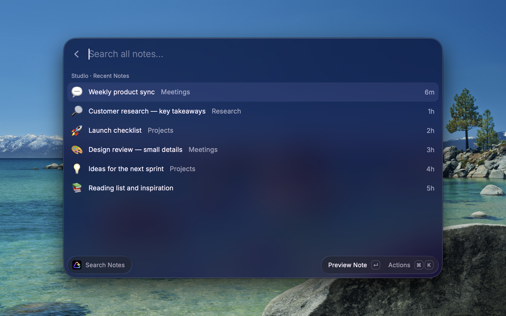

# Prismical for Raycast

Find your meeting notes, read transcripts, and capture ideas without leaving your keyboard.

[Prismical website](https://prismical.ai) · [Prismical on GitHub](https://github.com/amicalhq/prismical)

## What you can do

- **Search Notes** — find a meeting note, preview its Markdown, and read its available transcript. Open it in Prismical or copy its content and link.
- **Create Note** — capture an idea, selected text, or clipboard text in a new note and choose its folder.
- **Append to Note** — add a follow-up to an existing note without replacing its content.

Set aliases and keyboard shortcuts for these commands in Raycast Settings.

## Get started

You’ll need macOS, Raycast, and a Prismical account for search and text capture.

1. Open the [Prismical app](https://app.prismical.ai) and go to **Settings → API & MCP**.
2. Create an API key for your workspace.
3. Open a Prismical command in Raycast and enter the key in **Prismical API Key**.

Search and capture use the workspace connected by your API key. To switch workspaces, replace it in the extension’s preferences. You can revoke the key in Prismical at any time.

## Desktop recording shortcuts

- **Start Recording in New Note** — open a fresh floating note and start recording in the Prismical desktop app. If a recording is already active, show its note instead.
- **Stop Recording** — stop the active desktop recording, including recordings started from the main app or floating widget.

Install a Prismical for Mac build with Raycast recording shortcut support. The extension checks compatibility and asks you to update when needed. Desktop recording commands do not need an API key. They use the desktop app’s current workspace, including local mode, and its existing recording setup and permissions.

Prismical shows whether recording actually starts. If startup times out, check the app before trying again. Stopping also cancels a pending Raycast start; a note already created is kept.

## Privacy and saved drafts

Your API key is stored in Raycast’s password preferences. Requests go directly to Prismical, and the extension adds no analytics. Clipboard and selected text are read only when you choose those actions, and are appended to text already in the form. Note previews omit embedded images and raw HTML to avoid loading external content; copied Markdown remains unchanged.

If a save is interrupted, the extension keeps recovery text locally. Follow the prompt to check whether the note saved before retrying. **Discard Saved Recovery** removes the local recovery text without deleting your note in Prismical.

Raycast preserves unsent text in the standalone **Create Note** command. When creating or appending from within another command, unsent text is not retained after leaving the form.
